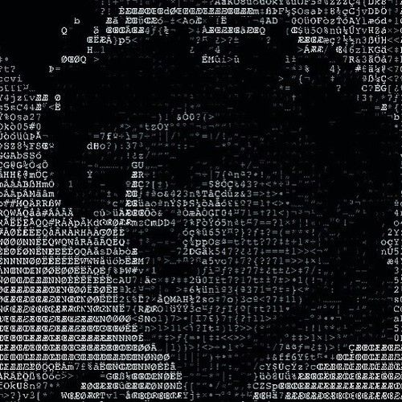

<h2>E aí, eu sou o <a href="https://github.com/balzaNeli">balzaNeli</a></h2>

Sou estudante de Desenvolvimento de Sistemas na ETEC e gosto de entender como software e hardware funcionam por dentro. No dia a dia, divido meu tempo entre criar aplicações web, escrever código em C++ e Python, montar beats de trap no FL Studio e mexer com modelagem 3D no Blender.

  

<code>// Menos código mágico, mais controle sobre o que roda por baixo do capô.</code>

<h2>Sobre mim</h2>
<ul>
  <li>Trabalhando no <strong>Farol</strong>, um app de espelhamento de tela local em baixa latência para Windows e Fire TV.</li>
  <li>Estudando estruturas de dados em C++, arquiteturas web com React e TypeScript, e desenvolvimento Android com Kotlin.</li>
  <li>Meus códigos e experimentos ficam nos repositórios do <a href="https://github.com/balzaNeli">GitHub</a>.</li>
</ul>

<h2>Projetos em destaque</h2>

  
Explorar repositórios

  <ul>
    <li><a href="https://github.com/balzaNeli/VeroList">VeroList</a> — App Android feito com Kotlin, Jetpack Compose, Room e arquitetura MVVM.</li>
    <li><a href="https://github.com/balzaNeli/Aprendendo-A-Criar-API">Aprendendo a criar uma API</a> — Backend em Node.js, Express, Prisma e MongoDB.</li>
    <li><a href="https://github.com/balzaNeli/Aprendendo-Vite-React">Aprendendo Vite + React</a> — Estudos de interfaces e componentes modernos na web.</li>
    <li><a href="https://github.com/balzaNeli/Programac-o-e-Algoritmos">Programação e Algoritmos</a> — Exercícios de lógica e estruturas em C++ e Portugol.</li>
    <li><a href="https://github.com/balzaNeli/CPP/blob/6ef9471cf6f30eb75572d8825f45b3a1a2ade0c5/ExerciciosAvancados/calculadoraPOO.cpp">Calculadora POO</a> — Calculadora orientada a objetos escrita em C++.</li>
    <li><a href="https://github.com/balzaNeli/siteconversordemoedas">Site Conversor de Moedas</a> — Conversor interativo feito em HTML, CSS e JavaScript.</li>
  </ul>

<h2>Ferramentas que eu uso</h2>

  
  
  
  
  
  
  
  
  
  
  
  
  

 

  
  

